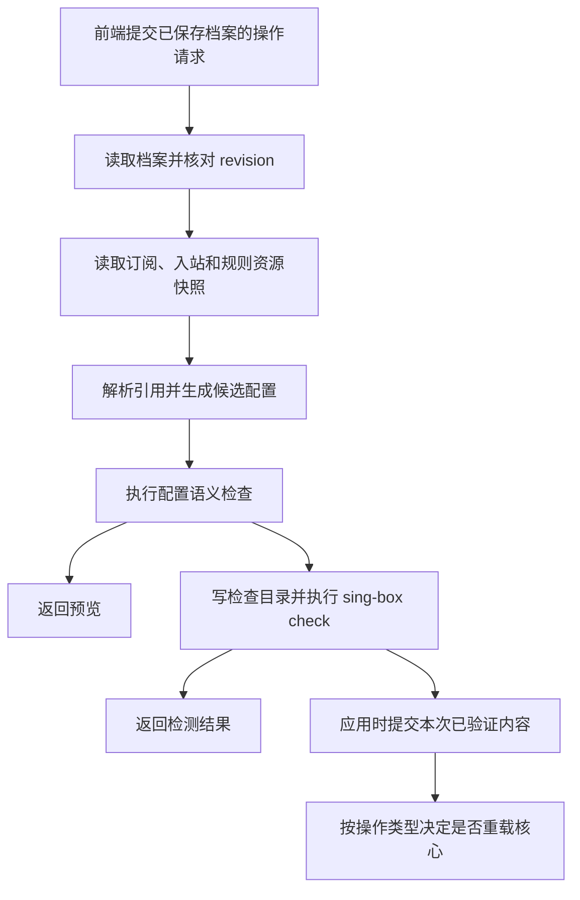

# 前后端职责与配置引用优化方案

日期：2026-09-23。审核基于代码提交 `cb6b6d0`（v0.1.4）及原文修订 `2d2de81`。

本文审核并吸收[原职责边界说明](architecture-responsibility-boundary.md)，明确当前问题、目标职责和实施顺序。文中的“当前”是已核对的代码行为，“目标”和“步骤”是待实施方案，不能视为已经完成的功能。

核心原则：**前端负责表达用户的配置意图和展示结果；后端负责将配置意图与源资源组合成可运行配置，并统一执行检查、应用和运行操作。**

## 1. 原文审核结论

原文提出把订阅、入站的引用解析集中到后端，方向合理。需要修正的是对当前后端能力的描述、“只记编号”的数据模型，以及“一次需求只改一处”的承诺。

| 原文观点 | 判断 | 本文采用的表述 |
| --- | --- | --- |
| 页面负责给人看、给人改，配置整理放服务器 | 保留并限定 | 表单状态、展示排序、即时语法提示仍在前端；决定最终配置内容的引用解析和跨模块转换由后端统一负责 |
| 当前服务器只是检查、复制文件 | 不够准确 | 后端已经负责草稿持久化、规则快照、规则集注入、语义检查、核心检查、文件事务和进程管理；缺少订阅与入站的统一引用解析 |
| 规则集的做法可以作为参照 | 保留 | 复用“保存绑定、服务端读取资源快照、生成配置”的方向；入站和订阅还需要别名、策略组、过滤、顺序等专用语义，不能照搬规则绑定字段 |
| 档案只记资源编号 | 不完整 | 引用条目记录来源和使用方式；独立 JSON、策略组参数、过滤条件、本地名称及顺序仍属于档案输入 |
| 页面独立，彼此只知道编号 | 部分保留 | 页面通过明确的 API 和数据类型协作；共享纯表单、按钮、格式化函数可以保留，页面不应承担其他模块的配置生成职责 |
| 仪表盘依赖出站整理代码 | 事实成立，影响需限定 | 仪表盘展示函数导入了出站编辑器模型；实际节点选择已经由后端转发给核心并读回确认，不能说运行选择也由浏览器决定 |
| 改同步只需改“同步”一处 | 作为方向保留，不能作为文件数承诺 | 同一种生成规则只有一个权威实现；修改 API、业务模型或交互时，相关类型、组件、测试和文档仍需更新 |
| 入站库“导入后互不联动”的文案过期 | 确认成立 | 列入修正项；代码注释也需同步，不能仅修正文档 |
| 分步迁移，不重写整个项目 | 保留并补充 | 先兼容旧档案并统一后端生成，再切换前端，最后迁移持久化模型；每步要有验收和回退条件 |

`cb6b6d0` 的 20 个文件包括 10 个业务文件、7 个测试文件、3 个文档与版本文件；新增 748 行中有 440 行测试。它同时处理了订阅更新失效和入站关联需求。文件数不能单独证明过度修改，应检查是否出现重复业务规则、入口行为不一致和无关改动。

## 2. 当前问题与代码依据

优先级“高”表示影响配置一致性或操作结果，“中”表示增加维护成本或造成使用误解。下表区分已确认行为与由此产生的限制，不把所有结构问题都当作已发生的运行故障。

| 问题 | 当前事实与影响 | 优先级 | 依据 |
| --- | --- | --- | --- |
| 同步依赖浏览器入口 | 前端预览、检测、应用先读取订阅和入站，再保存重建后的草稿；后端检测只读取草稿和规则快照。直接调用 API、后台自动重载不能自行刷新这些引用 | 高 | [application/store.ts](../web/src/features/application/store.ts) 的 `prepare`；[references.ts](../web/src/features/application/references.ts)；[configgen/handler.go](../internal/configgen/handler.go) 的 `loadSnapshot` |
| 预览、检测会间接引发配置写入 | 源内容变化时，前端同步会保存草稿。开启自动重载且操作当前已应用档案时，保存钩子可能先应用并重启核心，然后才继续原来的预览或检测 | 高 | [application/store.ts](../web/src/features/application/store.ts)；[profile/handler.go](../internal/profile/handler.go) 的 `putDraft`；[app/server.go](../internal/app/server.go) 的草稿保存钩子 |
| 业务引用混在编辑器状态中 | 入站来源、订阅引用及过滤条件保存在 `editorState`，后端目前只按 JSON 保存，没有统一解释；该字段在 Go 模型中仍被定义为界面编辑状态 | 高 | [profile/model.go](../internal/profile/model.go)；[config-editor/inbound.ts](../web/src/features/config-editor/inbound.ts)；[config-editor/outbound.ts](../web/src/features/config-editor/outbound.ts) |
| 资源变更状态覆盖不完整 | 规则已有资源摘要和 `needsApply` 更新机制；入站、订阅服务没有对应的档案依赖通知。源变了但草稿 revision 不变时，现有状态和此前检测结论不足以说明配置是否仍是最新 | 高 | [profile/service.go](../internal/profile/service.go) 的 `ReconcileResourceDigests`、`ReferencesForResource`；[inbounds/service.go](../internal/inbounds/service.go)；[subscriptions/service.go](../internal/subscriptions/service.go) |
| 来源与生成结果同时维护 | 草稿既存展开后的入站、出站 JSON，又存来源元数据，需要处理两者不一致、本地编辑解绑和删除旧节点；仅搬动代码位置无法消除这种复杂度 | 中 | [references.ts](../web/src/features/application/references.ts)；[ConfigWorkspace.vue](../web/src/features/config-editor/ConfigWorkspace.vue) 的 `persist` |
| 生成规则与编辑器、展示代码相连 | 出站展开、名称冲突处理、历史 sniff 转换在前端编辑器模块；仪表盘展示复用出站编辑器模型。更改业务规则容易连带影响其他入口 | 中 | [outbound.ts](../web/src/features/config-editor/outbound.ts) 的 `materializeOutbounds`；[inbound.ts](../web/src/features/config-editor/inbound.ts) 的 `applyInboundRouteIntents`；[dashboard/proxy-groups.ts](../web/src/features/dashboard/proxy-groups.ts) |
| 文案和注释与实际行为不一致 | 入站库仍写“只复制当前内容”“互不关联”；后端入站模型注释仍说档案不保留来源 ID，但新导入已经保留关联 | 中 | [InboundResourcesView.vue](../web/src/features/inbounds/InboundResourcesView.vue)；[inbounds/model.go](../internal/inbounds/model.go) |

已有的后端能力应继续复用：[规则资源快照](../internal/rules/snapshot.go)、[配置生成器](../internal/configgen/generator.go)、[语义检查](../internal/configgen/semantic.go)、[应用协调器](../internal/application/coordinator.go)、[运行节点选择](../internal/runtime/proxies.go)。尤其是应用协调器已经复制本次检查返回的配置内容，不应迁移成“检查一次，提交时再生成另一份”。

`buffers` 保存编辑原文，`config` 提供解析视图，这种区分有保留未知字段和数字精度的用途。优化重点是分清输入和派生结果，不是简单删除所有看起来重复的数据。

## 3. 前后端职责

| 事项 | 前端职责 | 后端职责 |
| --- | --- | --- |
| 表单与页面 | 输入、焦点、弹窗、筛选列表、主题、响应式展示 | 提供数据和可用能力，不接管浏览器交互 |
| 即时校验 | 提示 JSON 语法、必填项、明显重复名称，保留未完成输入 | 权威校验输入结构、资源存在性、引用关系及最终配置；不依赖前端已校验 |
| 入站、订阅资源库 | 展示摘要，按需编辑完整内容，提交资源操作 | 保存源内容、生成 ID、记录版本或内容摘要、返回变更影响 |
| 档案编辑与保存 | 维护本地未保存内容，防抖保存，携带 ETag，处理冲突 | 原子保存档案输入，检查 `If-Match`，管理 schema 版本和兼容迁移 |
| 建立、解除关联 | 让用户选择来源、本地名称或独立维护方式 | 校验并保存关联；按明确请求把当前内容固定为独立配置 |
| 订阅展开 | 展示后端返回的成员概览及错误 | 执行整订阅/单节点引用、过滤、去重、别名分配和引用重映射 |
| 入站及路由转换 | 展示源入站与本地别名，提供路由编辑交互 | 生成关联入站；处理本项目支持的历史 sniff 转换，保护用户自行编写的路由 |
| 预览与检测 | 请求操作、显示进度、结果和字段定位 | 从同一生成流程取得候选配置；执行语义检查和 sing-box 检查 |
| 应用与自动重载 | 发出明确操作，呈现服务端实际结果 | 检查、原子更新正式目录、记录应用状态；按既有设置决定是否重载 |
| 仪表盘及运行控制 | 格式化状态，提交选择、启动、停止等请求 | 向核心执行操作并确认结果；运行成员和选中节点以核心为准 |
| 依赖是否过期 | 展示“资源已更新”“需要重新应用”等状态 | 比较草稿输入和源资源版本，决定此前检测或应用状态是否过期 |

前端可以保留辅助校验，但不能维护另一套决定最终输出的订阅展开算法。共享纯 UI 组件是正常复用；某页面直接修改另一模块的最终配置，则应由业务服务接管。

后端模块也保持分工：资源服务维护资源，档案服务维护配置输入，配置生成流程负责组合，应用协调器负责写正式目录和运行操作。资源服务不直接批量重写所有档案，配置生成器也不直接启动核心。

## 4. 明确数据的用途

需要区分五类数据：资源库中的源内容、用户保存的档案输入、本次生成的候选配置、已应用到正式目录的配置、核心实际运行的配置。手动“应用”当前不会重启核心，因此“已应用”不能直接等同于“正在运行”。

目标档案采用以下职责划分。这里规定逻辑模型，新增字段名称和完整 JSON 契约在实施步骤 0 中确定。

| 数据 | 保存内容 | 用途 |
| --- | --- | --- |
| 独立配置输入 | 用户自行维护的 JSON、策略组参数、DNS、路由及未知字段 | 保留现有原始 JSON 编辑能力 |
| 有版本的业务引用 | 入站来源 ID、本地名称；订阅 ID、单节点定位、组成员引用、过滤条件、顺序等 | 后端生成配置的正式输入，不再依赖 UI 私有状态 |
| UI 状态 | 图标、面板展开状态、当前标签页、仅影响展示的隐藏标记 | 不决定源资源解析结果，不进入 sing-box JSON |
| 候选视图 | 展开后的入站、出站、必要路由及来源摘要 | 由后端生成并返回，不能同时作为另一份可独立修改的权威输入 |
| 检测与应用记录 | 草稿 revision、依赖摘要、候选摘要、检测结论、应用结果 | 说明某次操作究竟使用了哪些内容 |

`include`、`exclude` 会改变实际节点集合，属于业务输入；已自动生成条目的归属和历史 sniff 迁移记录也影响正确性，不能因为它们不属于 sing-box 字段就归为纯 UI 状态。DNS、路由的其他编辑状态暂不一并迁移。

现有 `bindings` 规则绑定可先保留，通过适配器接入统一生成流程。没有必要为字段形式一致，立即重写已经工作的规则资源模块。

引用行为必须明确：

1. 关联入站使用最新源内容，并保留档案中的本地 `tag`。源重命名不擅自改变本地路由引用。
2. 整订阅引用随源节点增删重新展开；指定单节点不存在时返回错误。当前节点只有 `tag` 可作为单节点定位依据，不按“长得相似”自动重连。
3. 独立 JSON 保持独立；旧档案没有来源 ID 的条目不按同名推断。用户可手动建立关联。
4. 关联内容的本地编辑采用现有“保存为独立配置”语义；解绑、复制时固定用户所见候选内容，并记录其来源版本，避免复制另一份已过期内容。源已删除时，允许用户明确将仍保留的已保存副本转为独立配置，但应说明这是此前内容，不能显示为同步成功。
5. 源读取失败或被删除时停止生成，保留草稿及正式配置，不悄悄退回旧副本。删除是否阻止有引用的源资源，需要有明确契约；首轮迁移保持现有删除行为，并让受影响档案显示失效引用。
6. 同名冲突、成员顺序和 `detour` 等重映射必须确定、可复现；默认节点被移除等情况明确报错，不能静默选一个替代节点。
7. 只转换本项目已支持且能确认归属的历史 sniff 配置；不删改外形相似的手工路由，不扩展为通用 sing-box 版本迁移器。

## 5. 后端统一生成流程

建议在现有 `internal/configgen` 周围增加引用读取和解析能力，继续由 `internal/application` 编排应用。不增加独立服务或新的前端框架。

内部生成结果至少包含 `draftRevision`、按资源类型区分的源版本或内容摘要、`configDigest`、模块内容和字段诊断。复用现有 `code`、`stage`、`fieldPath` 错误结构，补充引用解析阶段；错误应能定位到关联条目，不暴露资源中的凭据。

资源读取与纯计算分开：读取层负责获得源快照、去重读取和失败处理；解析层只接收不可变输入，负责展开与转换；输出层沿用现有固定文件名、语义检查和检查目录。这使解析算法可以脱离浏览器和磁盘单独验证。

需要满足以下约束：

- “最新”指操作取得快照时服务端已保存的内容。订阅目前是本地 JSON 集合；解析引用不等于新增远程订阅抓取，也不应在检测时暗中下载缺失规则。
- 同一档案输入与同一组源快照生成相同结果。未知 JSON 字段和大整数不能因前后端往返丢失；后端继续使用 `json.RawMessage`、`UseNumber` 等既有能力。
- 不在生成阶段写回用户草稿。返回的候选视图供页面展示，不再为了显示最新内容制造一次草稿保存。
- 当前语义检查会读取 `buffers` 并覆盖解析视图。移植时必须让检查与输出使用同一份解析结果；只修改内存 `config`、继续保留旧 `buffers` 会让检查仍看到旧内容。
- 应用必须在同一操作内生成、检查、提交。保护草稿与依赖在检查到提交期间的一致性；发生变化时返回可重试冲突，不能把不同内容的结果标成已验证。
- 对规则文件等可变外部文件，资源锁或等效版本保护需覆盖实际使用区间。记录一个摘要本身不能防止文件随后被替换；沿用固定规则文件的方案，首轮不引入长期版本归档。
- 预览、检测、应用是不同请求，期间源可能变化。应用仍重新生成并检查；检测记录要关联依赖摘要，不能仅凭相同 draft revision 复用旧结论。
- 资源变更后，服务端标记引用档案需要更新，并使旧检测结论失效。缓存可以加速，但不能成为决定“是否最新”的唯一依据；`updatedAt` 不作为唯一并发版本依据。

过滤规则移植需要专项对照：当前 `smartMatcher` 使用 JavaScript 正则，非法正则会退回字面匹配；Go 标准正则并不支持所有 JavaScript 语法。迁移前必须盘点兼容范围，已有表达式不得静默换含义；无法支持时给出具体过滤字段诊断及迁移办法。

## 6. 操作边界和副作用

| 操作 | 是否保存用户输入 | 是否更新正式 `config/` | 是否操作核心 |
| --- | --- | --- | --- |
| 保存入站、订阅或规则源 | 保存源并更新依赖状态 | 不因引用状态更新而应用档案 | 不因源保存自动重载；以后若增加此策略，需单独设计 |
| 保存档案 | 保存用户编辑和引用关系，revision 递增 | 仅在既有自动重载设置满足条件时进入应用流程 | 沿用当前设置：只处理当前已应用档案，运行中的核心才重载 |
| 预览 | 不保存派生结果，不递增草稿 revision | 否 | 否 |
| 检测 | 不保存派生结果；可保存检查目录和诊断记录 | 否 | 执行独立 `sing-box check`，不启停运行核心 |
| 手动应用 | 不把派生结果反写成档案输入；记录应用结果 | 检查成功后原子更新 | 保持现有语义，不自动重启 |
| 自动重载 | 不再次保存档案，不递归触发保存钩子 | 检查成功后更新 | 核心运行时重载；已停止时保持停止 |

前端操作针对已保存的档案。存在未保存内容或保存冲突时，先等待已有保存完成或提示用户处理；预览、检测内部不再通过“同步并 PUT 草稿”推进操作。

用户正常编辑仍可能触发已开启的自动保存和自动重载。这与预览、检测自身产生写入必须区分；页面等待这类操作完成，日志和返回结果记录触发原因，避免把同时完成的自动重载显示成“检测导致重启”。

## 7. 分阶段优化步骤

各阶段独立提交和验证。先解决所有入口生成一致的问题，再优化存储模型和组件依赖；不把清理目录结构作为第一步。

### 步骤 0：固定行为和兼容契约

工作：整理当前引用类型、独立 JSON、本地别名、过滤、去重、节点字段删除、sniff 归属、源缺失的行为；确定新业务引用 schema、错误字段以及源摘要的定义。用合成数据保存前后端对照样例，记录哪些行为保持、哪些错误需要改进。

验收：测试样例覆盖已有关键同步用例；明确 JavaScript/Go 正则差异；明确预览、检测、应用、保存和重载各自副作用。没有来源 ID 的旧入站不会被自动归类为关联入站。

回退：此步不改变生产数据和操作路径。

### 步骤 1：后端兼容旧格式并统一解析

工作：后端通过有限的旧格式适配器读取 `editorState` 中已经明确保存的来源 ID，不重新猜测来源。新增资源快照读取和纯解析函数；预览、检测、手动应用及自动重载全部调用同一生成流程。将订阅、入站纳入依赖摘要、检测过期和 `needsApply` 的处理；资源读取失败时不得回退到旧生成节点。

主要边界：`internal/configgen`、`internal/profile`、入站/订阅资源服务的读取契约、`internal/application`。旧格式生成条目依其归属记录替换，保护独立 JSON，避免旧浏览器已展开一次后服务端又重复追加。适配器只解释支持的版本；元数据损坏或与草稿矛盾时明确报错，不能把解析失败当作“没有引用”继续操作。

验收：不打开浏览器，直接调用三个 API 和自动重载路径，也能读取修改后的源；删除的 `detour` 不残留；相同输入重复生成不增删节点；生成不会修改草稿 revision；源删除产生明确错误；检查与提交内容一致。

回退：这一阶段保留旧磁盘格式，解析兼容仅发生在内存中，可以恢复此前程序行为。后端能力验证通过前，不删除前端旧路径；该阶段单独上线时，浏览器原有同步写回的副作用仍可能存在，需由下一步消除。

### 步骤 2：切换前端操作，取消同步写回

工作：前端经能力声明确认后端已支持引用解析，预览、检测、应用只提交档案 ID 和 revision。删除这些操作中的浏览器资源拉取、展开和草稿写回。通过后端返回的候选概览更新卡片及预览，区分“保存的输入”和“本次实际生成内容”。入站库过期文案及模型注释一并修正。

后端兼容能力和页面切换配套发布。旧页面缓存仍可能存在，服务端应保证旧请求也经过统一解析；前端应提示刷新到匹配版本，不能把后端正确性建立在用户已经刷新页面的假设上。

验收：没有用户编辑时点击预览或检测，不出现草稿 PUT、不增加 revision；开启自动重载也不因这两个操作触发应用或重启。页面显示最新关联内容，失效来源能定位并重新关联/解除关联；编辑与复制不会拿到另一份过期缓存。

回退：此时仍使用旧持久化格式，可恢复前端旧入口，但会恢复此前写回草稿的限制；不能恢复成前后端同时独立认定不同结果的状态。

### 步骤 3：把业务引用迁出 `editorState`

工作：启用有版本的业务引用字段，独立配置与引用条目可混排。迁移明确保存的订阅引用、入站来源、本地别名、组参数和生成归属；纯 UI 信息继续放编辑器状态。展开结果仅作为服务端候选视图，不再与引用输入双向维护。

迁移规则：读取时兼容旧格式，写入新格式时按档案原子提交并核对 revision；只保留一个权威生成输入。移除旧生成副本前核对归属，无法可靠确认的条目保留为独立配置或给出待处理诊断。记录迁移版本，重复执行不得产生重复节点。

新格式写入前必须具备可验证的备份与回退路径。旧客户端不得把不认识的新字段当作空值覆盖；对不支持的 schema 明确拒绝写入并提示刷新。回退需匹配程序与数据版本，不能承诺只换回旧二进制就能读取新档案，也不能无提示丢弃迁移后的编辑。

验收：旧档案、含关联的新档案、独立 JSON 和混合档案都可打开、编辑、复制、检测；无来源的旧入站仍可手动关联；迁移幂等；未知字段和大整数保持；同一资源更新无需批量改写所有引用档案；完成隔离环境的回退演练。

### 步骤 4：收敛页面依赖并移除旧算法

工作：工作台管理档案输入，资源页管理源内容，仪表盘读取运行 API 和展示数据类型。将仍有复用价值的表单和展示函数提取为明确公共组件；删除已由服务端替代的展开、引用重映射、sniff 生成及兼容缓存逻辑，避免保留两套长期维护的实现。

验收：仪表盘不再通过编辑器算法决定成员或生成配置；用户输入与显示功能保持。调整一条生成规则时，其算法修改集中在后端，前端只在 API 或交互确实改变时跟随修改。

回退：纯组件和类型整理独立提交，依据步骤 3 的数据兼容约束回退；不能为恢复旧 UI 重新启用过期配置生成逻辑。

## 8. 验收与验证范围

| 场景 | 必须满足的结果 |
| --- | --- |
| 修改订阅字段或删除旧 `detour` | UI 与直接 API 都生成最新内容，旧字段不残留 |
| 整订阅增删节点，多个组引用同一节点 | 成员、顺序、过滤及去重结果确定；不因重复生成而漂移 |
| 指定节点或关联入站源消失 | 返回可定位错误；草稿、正式配置和运行核心不被失败操作改变 |
| 入站源改名、改端口 | 使用新参数，保留本地名称和相关路由引用 |
| 独立 JSON、旧档案、完整 JSON 编辑 | 无来源不猜测；未知字段和大整数保持；关联内容的本地修改按约定独立化 |
| 混合过滤与历史 sniff | 正则差异有明确处置；只处理可确认归属的自动规则，保护手工路由 |
| 同时编辑草稿、修改源或重复提交 | ETag、资源快照及操作协调生效，不覆盖新编辑，不提交未经本次验证的内容 |
| 同一 revision 的源资源发生变化 | 旧检测结论被标记过期；档案显示需要更新；应用重新生成和检查 |
| 开启自动重载后点击预览、检测 | 无内部同步保存，无由检查触发的配置应用或核心重启 |
| 正常保存当前档案、手动应用、自动重载 | 分别遵守第 6 节语义，失败与成功状态真实可辨 |
| 服务重启、旧客户端、新旧格式迁移 | 依赖状态可恢复；不丢引用；不支持的写入明确失败；回退经过验证 |

生成规则主要用 Go 单元与集成测试验证，前端测试覆盖交互、候选展示、错误定位和冲突处理。保留少量贯穿完整操作的浏览器测试，不把全部算法边界重复写成 UI 用例。

实现阶段按修改范围运行 `go test -race ./...`、`go vet ./...`、前端类型检查与单测；有 UI 变化时运行 E2E 和桌面/平板/手机、浅/深色、键盘交互检查。官方核心契约测试遵守项目已有二进制选择规则。验收使用隔离测试数据，不用正式运行目录试迁移。

## 9. 本轮优化边界

先完成订阅、入站、规则引用在配置生成时的一致处理，保留既有 JSON 编辑、语义检查、检查目录、原子应用和运行控制机制。DNS、路由全部表单后端化、微服务、事件总线、远程订阅下载、源资源修改后立即重载，都不属于上述步骤的默认范围。

本次交付为文档审核和方案整理。后续每次实际发布按项目规则递增版本，只生成和验证 `dist/` 产物，`Release/` 的部署和运行由用户维护。
