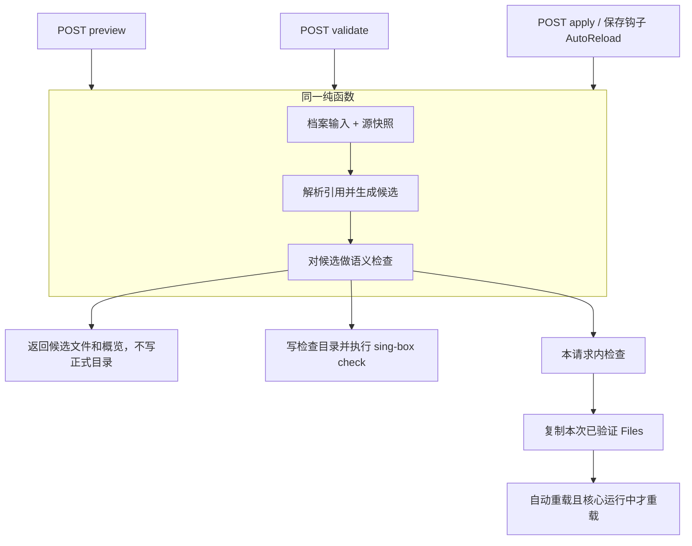

# 前后端职责与配置引用优化方案

日期：2026-09-23，2026-09-24 按代码审核及二次审核修订。审核基于代码提交 `cb6b6d0`（v0.1.4）及原文修订 `2d2de81`。

本文审核并吸收[原职责边界说明](architecture-responsibility-boundary.md)，明确当前问题、目标职责和实施顺序。原文中「档案只记编号」「每一步都能单独上线」「服务器只是检查、复制文件」等表述以本文为准。文中的“当前”是已核对的代码行为，“目标”和“步骤”是待实施方案，不能视为已经完成的功能。第 3 节职责表描述的是目标分工，不是现网能力。

核心原则：**前端负责表达用户的配置意图和展示结果；后端负责将配置意图与源资源组合成可运行配置，并统一执行检查、应用和运行操作。**

实施任务、依赖和验收见[配置引用职责迁移开发计划](plans/2026-09-24-reference-resolution-development-plan.md)。先完成后端统一生成和前端取消同步写回，再迁移业务引用数据、移除旧算法。新草稿格式不作为第一阶段的前置条件。

## 1. 原文审核结论

原文提出把订阅、入站的引用解析集中到后端，方向合理。需要修正的是对当前后端能力的描述、“只记编号”的数据模型，以及“一次需求只改一处”的承诺。

| 原文观点 | 判断 | 本文采用的表述 |
| --- | --- | --- |
| 页面负责给人看、给人改，配置整理放服务器 | 保留并限定 | 表单状态、展示排序、即时语法提示仍在前端；决定最终配置内容的引用解析和跨模块转换由后端统一负责 |
| 当前服务器只是检查、复制文件 | 不够准确 | 后端已经负责草稿持久化、规则快照、规则集注入、语义检查、核心检查、文件事务和进程管理；缺少订阅与入站的统一引用解析 |
| 规则集的做法可以作为参照 | 保留 | 复用“保存绑定、服务端读取资源快照、生成配置”的方向；入站和订阅还需要别名、策略组、过滤、顺序等专用语义，不能照搬规则绑定字段 |
| 档案只记资源编号 | 不完整 | 引用条目记录来源和使用方式；独立 JSON、策略组参数、过滤条件、本地名称及顺序仍属于档案输入 |
| 页面独立，彼此只知道编号 | 部分保留 | 页面通过明确的 API 和数据类型协作；共享纯表单、按钮、格式化函数可以保留，页面不应承担其他模块的配置生成职责 |
| 仪表盘依赖出站整理代码 | 事实成立，影响需限定 | 仪表盘展示函数导入了出站编辑器模型；实际节点选择已经由后端转发给核心并读回确认，不能说运行选择也由浏览器决定。`hidden` 仍会过滤运行中的组，步骤 4 抽展示 DTO 时必须带上 |
| 改同步只需改“同步”一处 | 作为方向保留，不能作为文件数承诺 | 同一种生成规则只有一个权威实现；修改 API、业务模型或交互时，相关类型、组件、测试和文档仍需更新 |
| 入站库“导入后互不联动”的文案过期 | 确认成立 | 列入修正项；过期文案不止两句，还包括“独立副本”“删除后已有副本不受影响”；代码注释也需同步 |
| 分步迁移，不重写整个项目 | 保留并补充 | 先兼容旧档案并统一后端生成，再切换前端，最后迁移持久化模型。磁盘格式不变不等于对浏览器用户无行为变化；步骤 2 的前端与能力开关必须配套发布 |

`cb6b6d0` 的 20 个文件包括 10 个业务文件、7 个测试文件、3 个文档与版本文件；新增 748 行中有 440 行测试。它同时处理了订阅更新失效和入站关联需求。文件数不能单独证明过度修改，应检查是否出现重复业务规则、入口行为不一致和无关改动。

来源 ID 目前写在前端 `editorState`（入站 `resourceBindings`、出站 `references`），后端当不透明 JSON 保存，入站服务本身没有档案关联表。

## 2. 当前问题与代码依据

优先级“高”表示影响配置一致性或操作结果，“中”表示增加维护成本或造成使用误解。下表区分已确认行为与由此产生的限制，不把所有结构问题都当作已发生的运行故障。

| 问题 | 当前事实与影响 | 优先级 | 依据 |
| --- | --- | --- | --- |
| 同步依赖浏览器入口 | 预览、检测、**应用**都先走 `prepare()`。有订阅/入站引用才读源；与快照有 diff 才 PUT 草稿。后端检测只读取草稿和规则快照。直接调用 API、后台自动重载不能自行刷新这些引用 | 高 | [application/store.ts](../web/src/features/application/store.ts) 的 `prepare`；[references.ts](../web/src/features/application/references.ts)；[configgen/handler.go](../internal/configgen/handler.go) 的 `loadSnapshot` |
| 预览、检测、应用会间接引发配置写入 | 源内容变化时，`prepare()` 会保存草稿。开启自动重载且操作当前已应用档案时，保存钩子可能先应用；核心运行中会重启，核心已停止仍会更新正式 `config/`。点应用时可能先被钩子重启，再发一次不重启的 `/apply` | 高 | [application/store.ts](../web/src/features/application/store.ts)；[profile/handler.go](../internal/profile/handler.go) 的 `putDraft`；[app/server.go](../internal/app/server.go) 的草稿保存钩子 |
| 业务引用混在编辑器状态中 | 入站来源、订阅引用及过滤条件保存在 `editorState`，后端目前只按 JSON 保存，没有统一解释；该字段在 Go 模型中仍被定义为界面编辑状态。`SaveDraft` 在请求带了 `editorState` 时整表替换，官方前端每次都发送该字段 | 高 | [profile/model.go](../internal/profile/model.go)；[profiles/api.ts](../web/src/features/profiles/api.ts)；[config-editor/inbound.ts](../web/src/features/config-editor/inbound.ts)；[config-editor/outbound.ts](../web/src/features/config-editor/outbound.ts) |
| 资源变更状态覆盖不完整 | 规则已有资源摘要和 `needsApply` 更新机制；入站、订阅服务没有对应的档案依赖通知。`ReconcileResourceDigests` 整表替换且只扫 `draft.Bindings`。`LastValidation` 不含资源摘要，源变后也不清除；现网检测/应用每次重做，它不能当成按 revision 跳过检查的缓存 | 高 | [profile/service.go](../internal/profile/service.go) 的 `ReconcileResourceDigests`、`ReferencesForResource`；[inbounds/service.go](../internal/inbounds/service.go)；[subscriptions/service.go](../internal/subscriptions/service.go) |
| 来源与生成结果同时维护 | 草稿既存展开后的入站、出站 JSON，又存来源元数据。双写发生在出站/入站保存和 `synchronizeReferences`；`ConfigWorkspace.persist` 对入站是 JSON 编辑后解绑，不是并排更新 | 中 | [references.ts](../web/src/features/application/references.ts)；[ConfigWorkspace.vue](../web/src/features/config-editor/ConfigWorkspace.vue) 的 `saveOutbounds` / `saveInbounds` |
| 生成规则与编辑器、展示代码相连 | 出站展开、名称冲突处理、历史 sniff 转换在前端编辑器模块；仪表盘展示复用出站编辑器模型。核心未运行时仪表盘用 `draft.config.outbounds` 当成员列表 | 中 | [outbound.ts](../web/src/features/config-editor/outbound.ts) 的 `materializeOutbounds`；[inbound.ts](../web/src/features/config-editor/inbound.ts) 的 `applyInboundRouteIntents`；[dashboard/proxy-groups.ts](../web/src/features/dashboard/proxy-groups.ts) |
| 出站与入站同步策略不一致 | 出站 JSON 与 `runtimeTags` 矛盾则报错、不自动修好；入站只要本地 tag 还在就用源覆盖，不检查字段是否被手改。出站 JSON 对话框改生成节点不会解绑 `editorState`，自动重载仍按 JSON 成功；入站 JSON 编辑会解绑 | 中 | [references.ts](../web/src/features/application/references.ts)；[inbound.ts](../web/src/features/config-editor/inbound.ts) 的 `detachEditedInboundResources` |
| 文案和注释与实际行为不一致 | 入站库仍写“只复制当前内容”“互不关联”“删除后副本不受影响”；后端入站模型注释仍说档案不保留来源 ID，但工作台导入已经把 `resourceId` 写入 `editorState` | 中 | [InboundResourcesView.vue](../web/src/features/inbounds/InboundResourcesView.vue)；[inbounds/model.go](../internal/inbounds/model.go) |

已有的后端能力应继续复用：[规则资源快照](../internal/rules/snapshot.go)、[配置生成器](../internal/configgen/generator.go)、[语义检查](../internal/configgen/semantic.go)、[应用协调器](../internal/application/coordinator.go)、[运行节点选择](../internal/runtime/proxies.go)。尤其是应用协调器已经复制本次检查返回的配置内容，不应迁移成“检查一次，提交时再生成另一份”。

`buffers` 保存编辑原文，`config` 提供解析视图，这种区分有保留未知字段和数字精度的用途。当前语义检查用 `buffers` 覆盖解析视图且 `json.Unmarshal` 不用 `UseNumber`；生成器只读 `draft.Config` 并用 `UseNumber`。优化重点是分清输入和派生结果，让检查与输出消费同一份候选，不是简单删除所有看起来重复的数据。

现网已有 `GET /api/v1/capabilities`，但是领域布尔（`application`、`subscriptions` 等），没有算法/schema 版本。步骤 2 需要新增字段，缺省按 false，不能复用 `application: true`。

## 3. 目标前后端职责

| 事项 | 前端职责 | 后端职责 |
| --- | --- | --- |
| 表单与页面 | 输入、焦点、弹窗、筛选列表、主题、响应式展示 | 提供数据和可用能力，不接管浏览器交互 |
| 即时校验 | 提示 JSON 语法、必填项、明显重复名称，保留未完成输入 | 权威校验输入结构、资源存在性、引用关系及最终配置；不依赖前端已校验 |
| 入站、订阅资源库 | 展示摘要，按需编辑完整内容，提交资源操作 | 保存源内容、生成 ID、记录版本或内容摘要、返回变更影响 |
| 档案编辑与保存 | 维护本地未保存内容，防抖保存，携带 ETag，处理冲突 | 原子保存档案输入，检查 `If-Match`，管理 schema 版本和兼容迁移；不支持的 schema 拒绝写入 |
| 建立、解除关联 | 让用户选择来源、本地名称或独立维护方式 | 校验并保存关联；按明确请求把当前内容固定为独立配置 |
| 订阅展开 | 展示后端返回的成员概览及错误 | 执行整订阅/单节点引用、过滤、去重、别名分配和引用重映射 |
| 入站及路由转换 | 展示源入站与本地别名，提供路由编辑交互 | 生成关联入站；处理本项目支持的历史 sniff 转换，保护用户自行编写的路由 |
| 预览与检测 | 请求操作、显示进度、结果和字段定位 | 从同一生成流程取得候选配置；执行语义检查和 sing-box 检查 |
| 应用与自动重载 | 发出明确操作，呈现服务端实际结果 | 检查、原子更新正式目录、记录应用状态；按既有设置决定是否重载 |
| 仪表盘及运行控制 | 格式化状态，提交选择、启动、停止等请求 | 向核心执行操作并确认结果；运行成员和选中节点以核心为准 |
| 依赖是否过期 | 展示“资源已更新”“需要重新应用”等状态 | 比较草稿输入和源资源版本，决定此前检测或应用状态是否过期 |

前端可以保留辅助校验，但不能维护另一套决定最终输出的订阅展开算法。共享纯 UI 组件是正常复用；某页面直接修改另一模块的最终配置，则应由业务服务接管。

后端模块也保持分工：资源服务维护资源，档案服务维护配置输入，配置生成流程负责组合，应用协调器负责写正式目录和运行操作。资源服务不直接批量重写所有档案，配置生成器也不直接启动核心。

## 4. 明确数据的用途

需要区分五类数据：资源库中的源内容、用户保存的档案输入、本次生成的候选配置、已应用到正式目录的配置、核心实际运行的配置。手动应用的协调器本身不会重启核心，因此“已应用”不能直接等同于“正在运行”。当前 UI「应用」按钮仍先走 `prepare()`，开启自动重载时保存钩子可能先重启，见第 6 节。

目标档案采用以下职责划分。旧格式的解析契约在步骤 0 中确定；新草稿字段、格式版本和写入兼容契约在步骤 3 迁移前确定。

| 数据 | 保存内容 | 用途 |
| --- | --- | --- |
| 独立配置输入 | 用户自行维护的 JSON、策略组参数、DNS、路由及未知字段 | 保留现有原始 JSON 编辑能力 |
| 有版本的业务引用 | 入站来源 ID、本地名称；订阅 ID、单节点定位、组成员引用、过滤条件、顺序等 | 后端生成配置的正式输入，不再依赖 UI 私有状态 |
| UI 状态 | 图标、面板展开状态、当前标签页、仅影响展示的隐藏标记 | 不决定源资源解析结果，不进入 sing-box JSON。仪表盘过滤隐藏组时仍需从展示 DTO 读取 `hidden` |
| 候选视图 | 展开后的入站、出站、必要路由及来源摘要 | 由后端生成并返回，不能同时作为另一份可独立修改的权威输入 |
| 检测与应用记录 | 草稿 revision、依赖摘要、候选摘要、检测结论、应用结果 | 说明某次操作究竟使用了哪些内容 |

`include`、`exclude` 会改变实际节点集合，属于业务输入；已自动生成条目的归属和历史 sniff 迁移记录也影响正确性，不能因为它们不属于 sing-box 字段就归为纯 UI 状态。DNS、路由的其他编辑状态暂不一并迁移。

现有 `bindings` 规则绑定可先保留，通过适配器接入统一生成流程。没有必要为字段形式一致，立即重写已经工作的规则资源模块。

当前独立/关联没有单独布尔：入站独立 = 该本地 tag 不在 `resourceBindings` 中；出站生成节点归属 = `generatedTags`。运行 JSON 禁止写入 `resourceId` / `sourceId`。

引用行为必须明确：

1. 关联入站使用最新源内容，并保留档案中的本地 `tag`。源重命名不擅自改变本地路由引用。structured 模式必须先剥 `sniff`、`sniff_timeout`、`sniff_override_destination`、`domain_strategy`、`udp_disable_domain_unmapping`，再把确认归属的嗅探写成路由规则；custom 模式才原样拷贝源对象。不要把源对象连同入站 sniff 字段一起写入后再追加路由 sniff。
2. 整订阅引用随源节点增删重新展开；指定单节点不存在时返回错误。当前节点只有 `tag` 可作为单节点定位依据，不按“长得相似”自动重连。编辑器 `restoreOutboundEditorState` 仍有内容相似匹配，同步路径不用；后端适配器禁止复用这条猜测。
3. 独立 JSON 保持独立；旧档案没有来源 ID 的条目不按同名推断。用户可手动建立关联。
4. 当前入站 JSON 编辑或「保存为独立入站」会解绑；出站 JSON 对话框改生成节点目前**不会**解绑。目标流程中，关联入站的解绑、复制及保存为独立配置，以用户正在查看的后端候选原始文本为准，并绑定该候选的草稿修订与源摘要；独立条目继续使用其编辑原文。不能将预览 `files[].content` 经 `JSON.parse` 再写回，也不能在页面已显示新内容时默默改用旧 `buffers`。源已删除、无法取得候选时，仅允许用户明确选择「保留此前已保存副本」恢复旧文本，并标明内容可能过期；没有可用副本则提示补充独立配置。
5. 源读取失败或被删除时停止生成，保留草稿及正式配置，不悄悄退回旧副本。`materializeOutbounds` 在订阅不在传入列表时的 `keepFallback` 是现网编辑器行为，目标生成路径不得沿用。删除是否阻止有引用的源资源，需要有明确契约；首轮迁移保持现有删除行为（入站/订阅可删、规则有引用则 409），并让受影响档案显示失效引用。
6. 同名冲突、成员顺序和 `detour` 等重映射必须确定、可复现。出站归属算法是**删掉整个 `generatedTags` 再物化**，不是按 tag 就地更新或追加；独立 JSON 只保留不在该集合中的条目。默认节点被移除等情况明确报错，不能静默选一个替代节点。现网整订阅缺节点会按剩余节点重展且不校验悬空 `default`，这是有意收紧，必须写入步骤 0 对照表。
7. 只转换本项目已支持且能确认归属的历史 sniff 配置；不删改外形相似的手工路由，不扩展为通用 sing-box 版本迁移器。保持现有插入、更新语义：新增托管 sniff 时插入开头，使其先于后续终结规则执行；已有托管规则在原位置更新或删除，不因职责迁移重排路由。多个入站可以产生多条托管规则，不要求它们最终都位于 `route.rules[0]`。入站展开同时维护托管规则归属和相关编辑位置，保护手工规则。
8. 出站同步：JSON 与 `runtimeTags` / 组类型矛盾时硬失败，不自动修好。入站同步：本地 tag 还在则按源覆盖；tag 已从数组消失则丢掉该绑定。两套策略写入对照表，后端不得擅自收成同一种。损坏或无法解析的 `editorState`（例如入站 `version !== 1` 或缺 `managedSniffRules`）不得当成「没有引用」继续；目标是明确报错。这比现网入站 restore 静默丢绑定更严，属于行为变更。

`include` / `exclude` 作用于源节点 tag、别名分配之前；对整订阅和 `subscription-node` 都生效。空 include = 全收，空 exclude = 不排除，不得把空串交给会匹配任意字符串的正则引擎。

## 5. 后端统一生成流程

建议在现有 `internal/configgen` 周围增加引用读取和解析能力，继续由 `internal/application` 编排应用。不增加独立服务或新的前端框架。

预览、检测、应用、自动重载是**不同入口**，共用同一个纯函数；应用不得复用上一次检测请求留下的产物，必须在本请求内重新生成并检查，再复制**本次** `Files`。

**禁止在引用展开前对旧 `buffers` 做权威语义检查。** 现码是先 `ValidateSemantic(draft)`（buffers 覆盖 config）再 `Generate`（只读 config）。移植时必须：展开 → 同一份候选 → 语义检查、核心检查、应用拷贝。不要只改内存 `config` 留下旧 `buffers`；也不要把 `parseDraft` 得到的 `map[string]any` 再 Marshal 当输出，那里没有 `UseNumber`，会丢掉超过 `2^53-1` 的整数。

内部生成结果至少包含 `draftRevision`、按资源类型区分的源版本或内容摘要、`configDigest`、模块内容和字段诊断。复用现有 `code`、`stage`、`fieldPath` 错误结构，补充 `resolve_references` 阶段；错误应能定位到关联条目，不暴露资源中的凭据。预览响应除现有 `files` / `digest` 外，步骤 2 需要轻量候选概览（组成员、本地 tag、源 id、过滤后数量、失效引用、是否独立），完整节点 JSON 不得经前端 `JSON.parse` 再写回档案。

资源读取与纯计算分开：读取层负责获得源快照、去重读取和失败处理；解析层只接收不可变输入，负责展开与转换；输出层沿用现有固定文件名、语义检查和检查目录。这使解析算法可以脱离浏览器和磁盘单独验证。

需要满足以下约束：

- “最新”指操作取得快照时服务端已保存的内容。订阅目前是本地 JSON 集合；解析引用不等于新增远程订阅抓取，也不应在检测时暗中下载缺失规则。规则调度器改文件是无浏览器的源变更入口，检测过期必须对它生效。
- 同一档案输入与同一组源快照生成相同结果。未知 JSON 字段和大整数不能因前后端往返丢失；后端继续使用 `json.RawMessage`、`UseNumber` 等既有能力。
- 不在生成阶段写回用户草稿。返回的候选视图供页面展示，不再为了显示最新内容制造一次草稿保存。
- 应用必须在同一操作内生成、检查、提交，复制本次检查的 `Files`。草稿 revision 在检查到提交期间变化则返回可重试冲突。入站、订阅使用本次读取的内存快照；源随后变更时保留本次使用的摘要、标记 `needsApply`，不得在提交时再生成另一份 JSON。
- 首轮对规则文件保留现有保护范围：生成和核心检查期间持有资源锁，检查返回后释放；最终 JSON 引用固定文件路径，目录提交前后该文件仍可能被调度器更新。这是真实资源变更，按现有摘要核对和 `needsApply` 机制标记，首轮不新增提交前资源冲突检查。因此本轮保证「提交本次检查过的 JSON」，不承诺「它引用的规则文件在检查结束后永不变化」。延长资源锁至提交或引入文件版本需要另行评估，不加入本轮职责迁移。
- 预览、检测、应用是不同请求，期间源可能变化。应用仍重新生成并检查；检测记录要关联依赖摘要，不能仅凭相同 draft revision 复用旧结论。现网 `LastValidation` 不能当跳过检查的缓存。
- 资源变更后，服务端标记引用档案需要更新，并使旧检测结论失效。`ReconcileResourceDigests` 若继续使用，必须合并规则、入站、订阅三类 digest，不能用入站-only map 整表替换从而冲掉规则摘要。缓存可以加速，但不能成为决定“是否最新”的唯一依据；`updatedAt` 不作为唯一并发版本依据。入站/订阅摘要算法（原始 `RawMessage` 哈希）在步骤 0 确定。

过滤规则移植需要专项对照：当前 `smartMatcher` 使用无 flags 的 JavaScript `RegExp`；空串表示「不限制」而不是编成匹配任意字符串的正则；非法正则退回字面匹配。Go 标准正则是 RE2。必须盘点两类差异：JS 有而 Go 没有的语法；Go 能编而 JS 会抛错后当字面的写法（例如 `(?i)hk`）。已有表达式不得静默换含义；无法支持时给出具体过滤字段诊断及迁移办法。步骤 1 若前端 JS 展开与后端 Go 展开并存，同一点击不能得到两套成员。

## 6. 操作边界和副作用

下表是**目标**语义。括号内是不得当作目标的现网偏差。

| 操作 | 是否保存用户输入 | 是否更新正式 `config/` | 是否操作核心 |
| --- | --- | --- | --- |
| 保存入站、订阅或规则源 | 保存源并更新依赖状态（现网仅规则会标 `needsApply`） | 不因引用状态更新而应用档案 | 不因源保存自动重载；以后若增加此策略，需单独设计 |
| 保存档案 | 保存用户编辑和引用关系，revision 递增 | 仅在既有自动重载设置满足条件时进入应用流程 | 沿用当前设置：只处理当前已应用档案；运行中才重载，已停止仍更新 `config/` 但保持停止 |
| 预览 | 不保存派生结果，不递增草稿 revision | 否 | 否（现网：有 diff 时 `prepare()` 会 PUT，可能触发上一行） |
| 检测 | 不保存派生结果；可保存检查目录和诊断记录 | 否 | 执行独立 `sing-box check`，不启停运行核心（现网 PUT 副作用同上） |
| 手动应用 | 不把派生结果反写成档案输入；记录应用结果 | 检查成功后原子更新 | 协调器 `Apply` 不自动重启（现网 UI 仍先 `prepare()`，自动重载开启时钩子可能先重启） |
| 自动重载 | 不再次保存档案，不递归触发保存钩子 | 检查成功后更新 | 核心运行时重载；已停止时保持停止 |

前端操作针对已保存的档案。存在未保存内容或保存冲突时，先等待已有保存完成或提示用户处理；预览、检测、应用内部不再通过“同步并 PUT 草稿”推进操作。

用户正常编辑仍可能触发已开启的自动保存和自动重载。这与预览、检测自身产生写入必须区分；页面等待这类操作完成，日志和返回结果记录触发原因，避免把同时完成的自动重载显示成“检测导致重启”。现网保存钩子与预览同步共用同一条 `autoReload` 文案，步骤 2 必须能区分。

无独立 CLI 生成入口；本机 Web 即全部 UI。档案复制（`POST /profiles/:id/copy`）整份复制 draft（含 `editorState` 与 `bindings`），与「复制入站行并冻结为独立配置」不是同一操作。

## 7. 分阶段优化步骤

各阶段独立提交和验证。先解决所有入口生成一致的问题，再优化存储模型和组件依赖；不把清理目录结构作为第一步。步骤 1 保持旧草稿输入格式，可独立合入；新增诊断元数据需验证兼容性。对已开启自动重载的引用档案，生成结果会变，不能当成对浏览器用户无行为变化的发布。步骤 2 的前端与能力开关必须配套发布。

### 步骤 0：固定行为和兼容契约

工作：整理当前引用类型、独立 JSON、本地别名、过滤、去重、节点字段删除、sniff 归属、源缺失的行为；确定旧格式的解析契约、错误字段以及源摘要的定义。用合成数据保存前后端对照样例，记录哪些行为保持、哪些错误需要改进。

步骤 0 固定以下约定，实现与测试在对应步骤落地。旧格式解析所需样例、规则、错误和摘要在步骤 1 前确定；候选概览、冻结内容和能力声明在步骤 2 切换前确定。新草稿 schema 与旧客户端拒写协议随步骤 3 实施，不提前阻塞旧格式的后端解析。

1. 对照样例目录，每条标明「保持现网 / 收紧为错误 / 有意改变」。至少覆盖：`reference-sync.test.ts` 的关键用例、多组共享同一节点、`generatedTags` 全集替换、tag 冲突 `name-2`、空 include/exclude、非法正则、Go 能编而 JS 当字面的正则、悬空 `default`、源数组重排、无 `resourceBindings` 的旧入站、损坏 `editorState`、出站 JSON 与 `runtimeTags` 不一致、出站 JSON 改生成节点未解绑、大整数 token、未知字段、structured 剥遗留字段、新增 sniff 插入开头、已有 sniff 原位更新、多个托管 sniff 共存、手工 sniff 外形相似、无 `generatedTags` 但 buffers 已展开。
2. JS/Go 正则矩阵与不支持时的诊断，禁止静默换含义。
3. 业务引用逻辑模型：入站绑定、整订阅/单节点、过滤、顺序、`generatedTags` 归属、托管 sniff 归属、独立 JSON 的识别（没有 binding，不是布尔字段）。
4. 错误契约：复用 `code` / `stage` / `fieldPath`；新 stage `resolve_references`；至少覆盖缺失源、缺失单节点、过滤不兼容、元数据与 JSON 矛盾、旧引用元数据版本不支持、归属不足。禁止把源凭据写进 message。
5. 摘要定义：入站/订阅用内容哈希，不用 `updatedAt`。检测记录 = `draftRevision + resourceDigests + configDigest`。
6. 能力声明名（在现有 `/api/v1/capabilities` 增加布尔，缺失 = false，禁止复用 `application: true`）及其与后端实际解析路径一致的启用条件。完整草稿 `schemaVersion` 和旧客户端拒写协议留到步骤 3。
7. 预览/检测响应 DTO：候选概览形状；完整节点不经 JS number 往返。
8. 解绑/复制/「保存为独立」使用当前展示的候选原始文本及其修订、摘要；独立条目使用编辑原文。明确恢复旧副本是另外一种操作，不能自动回退到草稿旧文本。
9. 第 6 节副作用按入口拆开：后端 POST 本身、前端 `prepare()`（步骤 2 删除）、保存钩子。
10. 相对 v0.1.4 的行为变更清单：损坏 editorState 报错、缺省节点、取消 `keepFallback`、出站 JSON 矛盾是否让自动重载失败、是否阻止删除仍被引用的入站/订阅（首轮保持可删）。

验收：测试样例覆盖已有关键同步用例；明确 JavaScript/Go 正则差异（含空串和反向不兼容）；明确预览、检测、应用、保存和重载各自副作用。没有来源 ID 的旧入站不会被自动归类为关联入站。

回退：此步不改变生产数据和操作路径。

### 步骤 1：后端兼容旧格式并统一解析

工作：后端通过有限的旧格式适配器读取 `editorState` 中已经明确保存的来源 ID，不重新猜测来源。新增资源快照读取和纯解析函数；预览、检测、手动应用及自动重载全部调用同一生成流程。将订阅、入站纳入依赖摘要、检测过期和 `needsApply` 的处理；资源读取失败时不得回退到旧生成节点。入站解析包含 structured 字段剥离、托管 sniff 的新增、原位更新与归属维护。

主要边界：`internal/configgen`、`internal/profile`、入站/订阅资源服务的读取与**写侧通知**、`internal/application`。旧格式生成条目按 `generatedTags` **全集删除再物化**，保护不在该集合中的独立 JSON；禁止就地替换或照搬规则集 append。适配器只解释支持的版本；元数据损坏、缺归属、或与草稿矛盾时明确报错，不能把解析失败当作“没有引用”继续操作，也不能追加节点。

能力开关在这一步加入，**默认关闭「后端再展开」**，仅测试与显式开启的环境走新解析。对照样例与现网 JS 输出幂等之前，不要让生产里的旧前端 PUT 与新后端展开同时生效。开启后：旧前端仍会先展开并可能 PUT，后端必须对同一输入幂等；`generatedTags` 缺失但 buffers 已展开时失败，不得猜测。

步骤 1 会改变自动重载：现网按草稿里已展开 JSON 应用（出站 JSON 手改生成节点也能成功）；开启后端再展开后，按源重展，出站 JSON 与引用矛盾会失败或覆盖手改。这必须出现在步骤 0 对照表，不能写成无行为变化。

验收：不打开浏览器，直接调用三个 API 和自动重载路径，也能读取修改后的源；删除的 `detour` 不残留；相同输入重复生成不增删节点；生成不会修改草稿 revision；源删除产生明确错误；检查与提交的 JSON 来自同一份候选，规则文件采用第 5 节明确的现有边界；新增 sniff 插入开头，已有规则原位更新，多条托管规则和手工规则共存时顺序保持。本步**不**验收「点击预览不 PUT」——那是步骤 2。

回退：保持旧草稿输入格式，新增检测及摘要字段必须通过旧程序读取兼容测试后，才能承诺恢复旧二进制；回退后自动重载/API 不再重读订阅/入站。开启后端再展开期间，已自动重载过的正式 `config/` 可能已按新算法生成，回退二进制不会自动还原那次写入。

### 步骤 2：切换前端操作，取消同步写回

工作：前端经能力声明确认后端已支持引用解析（字段存在且为 true；缺失当 false，继续走浏览器同步）。预览、检测、应用只提交档案 ID 和 revision。删除这些操作中的浏览器资源拉取、展开和草稿写回。通过后端返回的候选概览更新**工作台卡片、预览和核心未运行时的仪表盘成员列表**，区分“保存的输入”和“本次实际生成内容”。入站库过期文案（整页，含删除提示）及模型注释一并修正。

工作台最小产品行为：表单编辑已保存的配置意图；卡片中的生成成员、关联入站字段和托管 sniff 显示后端候选，并展示来源和更新状态。解绑/复制使用当前所见候选的原始文本及对应修订、摘要，禁止用 `JSON.parse` 后的预览 `content` 冻结。旧副本只在用户明确选择恢复时使用。JSON 对话框区分可编辑输入与只读生成结果；修改关联内容先明确转为独立配置，不能让编辑悄悄被后端覆盖。候选响应不得覆盖期间产生的本地编辑或另一档案的视图。

后端兼容能力和页面切换配套发布。旧页面缓存仍可能存在，服务端在开关开启后应保证旧请求也经过统一解析；前端应提示刷新到匹配版本，不能把后端正确性建立在用户已经刷新页面的假设上。

验收：没有用户编辑时点击预览、检测或应用，都不出现内部草稿 PUT、不增加 revision。预览、检测不更新正式配置、不重启核心；手动应用检查通过后正常更新正式配置，不因内部保存额外触发自动应用或重启。页面显示最新关联内容，失效来源能定位并重新关联/解除关联；解绑、编辑和复制保留用户所见内容及大整数。核心停止时仪表盘使用后端候选或已应用配置的明确来源，显示其状态，不继续依赖旧草稿中的展开副本，也不把候选误报为运行状态。

回退：此时仍使用旧持久化格式，可恢复前端旧入口，但会恢复此前写回草稿的限制；不能恢复成前后端同时独立认定不同结果的状态。

### 步骤 3：把业务引用迁出 `editorState`

工作：启用有版本的业务引用字段，独立配置与引用条目可混排。迁移明确保存的订阅引用、入站来源、本地别名、组参数和生成归属；纯 UI 信息继续放编辑器状态。展开结果仅作为服务端候选视图，不再与引用输入双向维护。

迁移规则：读取时兼容旧格式，写入新格式时按档案原子提交并核对 revision；只保留一个权威生成输入。移除旧生成副本前核对归属，无法可靠确认的条目保留为独立配置或给出待处理诊断。记录迁移版本，重复执行不得产生重复节点。档案打开、保存和复制复用同一转换规则；打开时仅在内存中适配，保存或复制时才按对应写入契约落盘。

新格式写入前必须具备可验证的备份与回退路径。旧客户端不得把不认识的新字段当作空值覆盖：当前 `SaveDraft` 会整表替换 `editorState`，官方前端每次 PUT 完整对象。对不支持的 schema 明确拒绝写入并提示刷新。回退需匹配程序与数据版本，不能承诺只换回旧二进制就能读取新档案，也不能无提示丢弃迁移后的编辑。

验收：旧档案、含关联的新档案、独立 JSON 和混合档案都可打开、编辑、复制、检测；无来源的旧入站仍可手动关联；迁移幂等；未知字段和大整数保持；同一资源更新无需批量改写所有引用档案；完成隔离环境的回退演练。

### 步骤 4：收敛页面依赖并移除旧算法

工作：工作台管理档案输入，资源页管理源内容，仪表盘读取运行 API 和展示数据类型（含 `hidden`）。将仍有复用价值的表单和展示函数提取为明确公共组件；删除已由服务端替代的展开、引用重映射、sniff 生成及兼容缓存逻辑，避免保留两套长期维护的实现。步骤 2 之后前端展开若仍用于编辑器保存，本步必须删掉，只留后端权威实现。

验收：仪表盘不再通过编辑器算法决定成员或生成配置；用户输入与显示功能保持。调整一条生成规则时，其算法修改集中在后端，前端只在 API 或交互确实改变时跟随修改。

回退：纯组件和类型整理独立提交，依据步骤 3 的数据兼容约束回退；不能为恢复旧 UI 重新启用过期配置生成逻辑。

## 8. 验收与验证范围

| 场景 | 必须满足的结果 |
| --- | --- |
| 修改订阅字段或删除旧 `detour` | UI 与直接 API 都生成最新内容，旧字段不残留 |
| 整订阅增删节点，多个组引用同一节点 | 成员、顺序、过滤及去重结果确定；不因重复生成而漂移 |
| 指定节点或关联入站源消失 | 返回可定位错误；草稿、正式配置和运行核心不被失败操作改变 |
| 入站源改名、改端口、开关 sniff | 使用新参数，保留本地名称和相关路由引用；structured 不把入站 sniff 字段写回；新增托管规则插入开头，已有规则原位更新，多条规则和手工规则顺序不被重排 |
| 独立 JSON、旧档案、完整 JSON 编辑 | 无来源不猜测；未知字段和大整数保持；入站本地修改按约定独立化；出站 JSON 与引用矛盾的处理与对照表一致 |
| 混合过滤与历史 sniff | 空串、非法正则、JS/Go 反向差异有明确处置；只处理可确认归属的自动规则，保护手工路由 |
| 同时编辑草稿、修改源或重复提交 | ETag、内存快照及操作协调生效，不覆盖新编辑；提交本次检查的 JSON；规则文件在检查后变更按第 5 节标记过期 |
| 同一 revision 的源资源发生变化 | 旧检测结论被标记过期；档案显示需要更新；应用重新生成和检查。规则调度器改文件也要标脏 |
| 开启自动重载后点击预览、检测 | 步骤 2 之后无内部同步保存，不更新正式配置，不重启核心 |
| 开启自动重载后点击手动应用 | 步骤 2 之后无内部同步保存；检查成功后正常应用一次，不额外触发自动应用或重启 |
| 候选内容已更新后解绑或复制 | 固定用户正在查看的候选原始文本，不恢复成旧草稿内容，不丢失大整数；恢复旧副本必须是明确选择 |
| 正常保存当前档案、手动应用、自动重载 | 分别遵守第 6 节语义，失败与成功状态真实可辨；文案能区分保存触发的重载和预览/检测 |
| 服务重启、旧客户端、新旧格式迁移 | 依赖状态可恢复；不丢引用；不支持的写入明确失败；回退经过验证 |
| 核心未运行时的仪表盘 | 步骤 2 之后成员列表来自候选或已应用配置，不停留在取消写回之前的草稿展开结果 |

生成规则主要用 Go 单元与集成测试验证，前端测试覆盖交互、候选展示、错误定位和冲突处理。保留少量贯穿完整操作的浏览器测试，不把全部算法边界重复写成 UI 用例。现有展开算法测试几乎全在前端；步骤 1 必须把对照样例变成 Go 测试，不能只靠浏览器用例。

实现阶段按修改范围运行 `go test -race ./...`、`go vet ./...`、前端类型检查与单测；有 UI 变化时运行 E2E 和桌面/平板/手机、浅/深色、键盘交互检查。官方核心契约测试遵守项目已有二进制选择规则。验收使用隔离测试数据，不用正式运行目录试迁移。

## 9. 本轮优化边界

先完成订阅、入站、规则引用在配置生成时的一致处理，保留既有 JSON 编辑、语义检查、检查目录、原子应用和运行控制机制。DNS、路由全部表单后端化、微服务、事件总线、远程订阅下载、源资源修改后立即重载，都不属于上述步骤的默认范围。

步骤 0–2 需要能力声明与缺省 false、候选概览、检测记录带依赖摘要、语义检查与生成共用候选、工作台区分输入与生成、解绑/复制保留当前候选文本。新草稿 schema 和旧客户端拒写协议在步骤 3 随持久化格式迁移落实，不把完整格式重构提前设为后端统一解析的前置条件。

本次交付为文档审核和方案整理。后续每次实际发布按项目规则递增版本，只生成和验证 `dist/` 产物，`Release/` 的部署和运行由用户维护。
